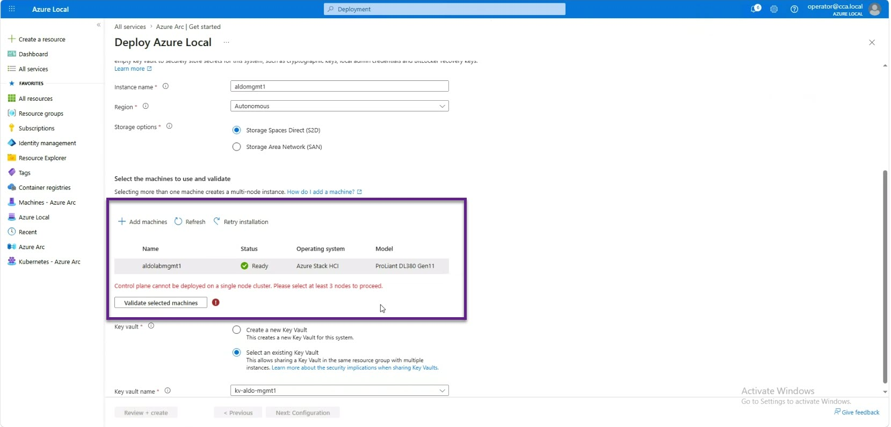

# Architecting an Azure Local Disconnected Operations Proof of Concept

Evaluating disconnected sovereign cloud architectures on-premises requires balancing an infrastructure footprint against operational realism. When staging a Proof of Concept (POC) for Azure Local Disconnected Operations (ALDO), deploying full production-tier topology isn't always practical. Microsoft accommodates early-stage validation through a flexible four-node hardware arrangements, allowing engineering teams to tailor their deployment model to specific evaluation objectives.

While several topology models exist, choosing a **Workload-Focused configuration** provides the most agile path for validating core application behaviours, deployment pipelines, and high availability without requiring a massive hardware investment up front.

## Exploring POC Topology Frameworks

A standard four-node allocation from the Azure Local catalogue can be architected into three distinct functional models:

### Option 1: Management-Focused (3-Node Control Plane + 1-Node Workload)

Prioritises absolute control plane isolation and high availability. By hosting the disconnected control plane services on a resilient three-node management cluster, teams can benchmark production-grade operational independence, control plane sizing, and platform lifecycle management.

### Option 2: Workload-Focused (1-Node Control Plane + 3-Node Workload) and this articles primary evaluation target

Optimises the environment for realistic application behaviour, storage resiliency, and workload placement. By condensing the management footprint onto a single control plane node, three nodes are freed to build a fully resilient workload cluster running Storage Spaces Direct (S2D) with 3-way mirroring. Alternatively, for cost-sensitive environments, the workload layer can be scaled down to a single node.

### Option 3: Multi-Cluster Focused (1-Node Control Plane + 3 x 1-Node Workloads)

Designed to test central governance across disparate edge environments. This option uses a single-node management appliance to oversee three independent single-node workload clusters, ideal for validating centralised inventory, multi-site visibility, and aggregated lifecycle operations.

## Deep Dive: Executing Option 2 (Workload-Centric Validation)

In enterprise edge deployments, the primary technical metric is often how application stacks perform under disconnected conditions, specifically around failover, storage IOPS, and local Azure Resource Manager (ARM) endpoint responsiveness.

Option 2 maximises validation value by providing a production-equivalent **3-Node Azure Local Workload Cluster** while minimising administrative overhead.

## Minimum Hardware Requirements for the Control Plane Node

When operating the disconnected control plane on a single host (IRVM01), hardware requirements remain strict to support the containerised and virtualised management microservices:

- **Memory:** 256 GB
- **Processor:** 24 Cores
- **Storage:** 4 TB dedicated NVMe/SSD storage pool + 960 GB boot drive

### Overcoming the Single-Node Management Cluster Barrier

When deploying Option 2, an intentional safety boundary in the platform's deployment logic must be navigated.

Once the initial appliance VM (**IRVM01**) is installed and the disconnected control plane services are running, the next step is cluster formation via the localised administration portal, accessible via your environment's custom FQDN, such as:

```
https://portal.autonomous.cloud.private/
```

### The Management Cluster Validation Block

Because production deployments strictly require a 3-node management cluster for quorum and resiliency, attempting to form or register the cluster through the standard web endpoint URL will result in a **hard validation block**. The deployment engine expects a multi-node control plane by default.


*Figure 1: ALDO Control Plane Portal*

### The Workaround: Passing the Feature Flag Query String

To bypass this check during a single-node management POC, a specific feature flag must be appended directly to the URI in the browser address bar (or API call):

```
https://portal.autonomous.cloud.private/?isManagementClusterAllowedToBeLessThan3Nodes=true
```

**Note:** In web and system architecture, a URL (Uniform Resource Locator) specifies _where_ a resource is located (\[<https://portal.autonomous.cloud.private/>), whereas appending the query parameter (?isManagementClusterAllowedToBeLessThan3Nodes=true) turns the address into a complete **URI** (Uniform Resource Identifier), identifying the specific request state and feature override being passed to the endpoint.

## Executing the Override

1. Navigate to your local portal endpoint URL.
2. Append ?isManagementClusterAllowedToBeLessThan3Nodes=true to the address bar and press **Enter**.
3. The platform will process the query string, override the 3-node minimum requirement, and allow the cluster creation workflow to proceed.
4. **Expected Warning:** The wizard will display a formal confirmation banner warning that deploying the disconnected control plane on fewer than three nodes is non-compliant with production SLA standards and should remain confined to staging and testing environments.

Acknowledging this banner unlocks full cluster creation functionality, allowing the single control plane host (IRVM01) to begin managing and orchestrating the multi-node workload cluster.

## Conclusion

Option 2 provides the ideal middle ground for technical proof-of-concept evaluations. By understanding the URL/URI parameter requirements to allow sub-3-node management clusters, architecture teams can rapidly build a lean, high-value staging environment that thoroughly tests Azure Local workload behaviour without committing to unnecessary hardware overhead during early validation phases.
